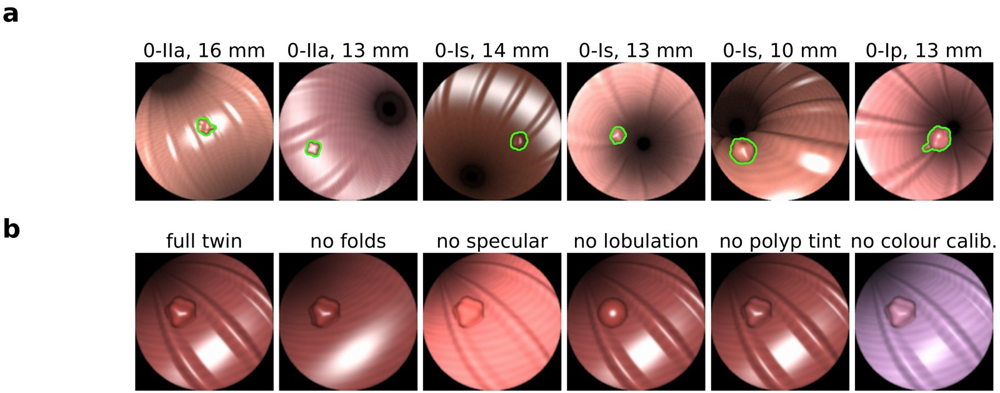
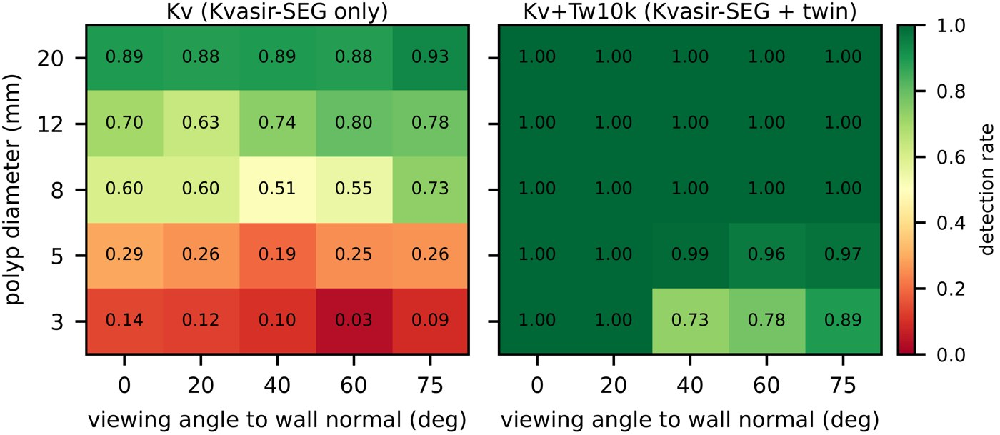

# GastroTwin

Code for **"Gastric Polyp Detection without Gastric Annotations Using a Stomach Digital Twin"**
(BVM 2027, paper 4028).

Open gastric polyp data are scarce and come without pixel masks. GastroTwin is a GPU-rendered
digital twin of the gastroscopic scene that produces stomach frames with exact polyp masks. We use it
in two ways: as a source of labelled training data for colon-trained detectors, and as a test bench
that audits detectors by polyp size, viewing angle and Paris type. No gastric annotation is used for
training.



## Main results

Image-level detection of gastric polyps on GastroVision (65 polyps, 954 normal images), seed
ensembles with 95 % bootstrap confidence intervals.

| Training data | Encoder | AUROC | AUPRC | Sens. @ 90 % spec. |
|---|---|---|---|---|
| Kvasir-SEG | ResNet-34 | 0.952 [0.918, 0.976] | 0.680 | 0.923 |
| Twin only | ResNet-34 | 0.823 [0.775, 0.871] | 0.249 | 0.477 |
| Kvasir-SEG + 3k twin frames | ResNet-34 | 0.954 [0.931, 0.973] | 0.685 | 0.877 |
| Kvasir-SEG | MiT-B2 | 0.899 [0.864, 0.932] | 0.419 | 0.738 |
| Kvasir-SEG + 3k twin frames | MiT-B2 | 0.953 [0.931, 0.972] | 0.653 | 0.846 |

Twin frames improve the transformer at every amount tested (+0.037, +0.054 and +0.032 AUROC with 1k,
3k and 10k frames, all p ≤ 0.008) and leave the already strong CNN unchanged. Removing rugal folds,
the polyp tint or specular highlights from the twin lowers the AUROC significantly (Holm-corrected).
In the in-silico audit, the colon-only detector finds 9 % of 3 mm and 25 % of 5 mm polyps.



## Repository layout

```
gastrotwin/
  config.py      experiment settings (paper defaults and a quick smoke-test setting)
  data.py        Kvasir-SEG / GastroVision loading and splits
  twin.py        signed-distance stomach scene, renderer, ablations, audit set
  baselines.py   Reinhard colour transfer and Poisson cut-paste
  model.py       U-Net training, inference, image score, Dice
  stats.py       seed ensembles, stratified bootstrap, paired tests, Holm correction
scripts/
  run_experiments.py   full pipeline: render, train all configurations, evaluate
  make_tables.py       all tables and statistics figures from the per-model score files
notebooks/
  GastroTwin_colab.ipynb   runs the pipeline on Google Colab
results/
  runs/*.npz     per-model outputs of the published runs (image scores, Dice, audit detections)
  *.csv, *.png   tables and figures rebuilt from these files
tests/
  test_twin.py   renderer smoke test
```

## Installation

```bash
git clone https://github.com/Darshan0109/GastroTwin.git
cd GastroTwin
pip install -e .
```

## Data

Both datasets are public. Download them from the providers and follow their terms of use.

- Kvasir-SEG: https://datasets.simula.no/kvasir-seg/
- GastroVision: https://osf.io/84e7f/

The scripts accept the downloaded zip files or the extracted folders.

## Reproducing the paper

### 1. Check the statistics from the published runs (no GPU, about a minute)

```bash
python scripts/make_tables.py --results results
```

This rebuilds Tables 1 to 3, the audit tables and the figures from `results/runs/*.npz`, which hold
the image scores of every model trained for the paper. The bootstrap uses a fixed seed, so the
numbers match the paper exactly.

### 2. Retrain everything

```bash
python scripts/run_experiments.py \
    --kvasir kvasir-seg.zip --gastrovision GastroVision.zip \
    --data-dir data --out my_results
```

On Colab, open `notebooks/GastroTwin_colab.ipynb` with an A100 runtime. Every model is cached in
`<out>/runs/`, so an interrupted run continues where it stopped. `--quick` runs a tiny smoke test.

| Config | Training data | Encoders | Seeds |
|---|---|---|---|
| A | Kvasir-SEG | ResNet-34, MiT-B2 | 5 |
| D | + colour-transferred Kvasir-SEG | ResNet-34 | 5 |
| E | + 3000 cut-paste images | ResNet-34, MiT-B2 | 5 |
| B | 10 000 twin frames only | ResNet-34 | 5 |
| C1k / C3k / C10k | + 1000 / 3000 / 10 000 twin frames | ResNet-34, MiT-B2 | 3 (R34 C1k), 5 |
| F | + twin + cut-paste | ResNet-34 | 5 |
| C3k-no_* | + 3000 ablated twin frames | ResNet-34 | 3 |

### What is fixed, and what can differ

Everything random is seeded: the Kvasir-SEG split (0), the GastroVision reference split (0), the twin
(42, ablation colours 43), colour transfer (3), cut-paste (7), the audit set (123), training
(0 to 4) and the bootstrap (0). The twin, the baselines and the data splits are therefore identical
on every machine up to floating-point differences between GPUs.

Training on a GPU is not bit-exact: cuDNN kernels and bf16 autocast are non-deterministic, so a
retrained model gives slightly different scores. Expect differences in the third decimal of single
models and smaller ones for the seed ensembles. To stay as close as possible, keep the default
batch size (32) and number of data-loader workers (8), because both change the random augmentation
stream. The exact published numbers come from `results/runs`.

The published runs used PyTorch with bf16 autocast on an NVIDIA A100 in Google Colab.
`run_experiments.py` records the PyTorch and segmentation-models-pytorch versions in
`run_info.json`.

## Citation

```bibtex
@inproceedings{bhatt2027gastrotwin,
  author    = {Bhatt, Darshan and Patel, Himanshu and Debnath, Manna and Parmar, Meet},
  title     = {Gastric Polyp Detection without Gastric Annotations Using a Stomach Digital Twin},
  booktitle = {Bildverarbeitung f{\"u}r die Medizin 2027},
  publisher = {Springer Vieweg},
  year      = {2027}
}
```

## License

MIT (see `LICENSE`). The datasets are not part of this repository and keep their own licenses.
